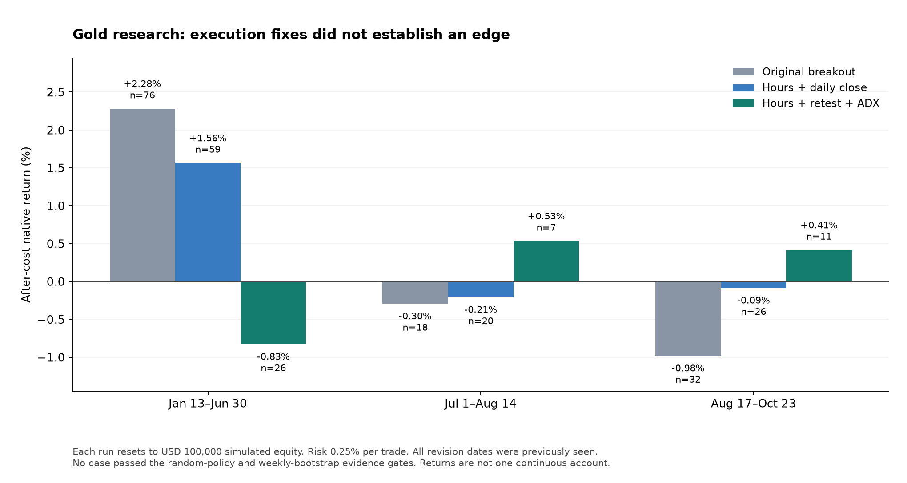

# MT5 backtest research

Original, tester-only XAUUSD research programs, simulated trade journals, random-direction benchmarks, and a record of unsuccessful strategy ideas.

**No dependable profitable edge was established.** The revised execution controls worked, but neither gold revision passed the evidence gates. All revised test periods were already examined; they are exploratory retests.



Each run resets to **USD 100,000 simulated equity**, with 0.25% planned stop risk. These are independent periods, not a continuous account. No money was deposited or traded live.

| Version | Jan 13–Jun 30, 2026 | Jul 1–Aug 14 | Aug 17–Oct 23 |
|---|---:|---:|---:|
| Original breakout | +2.278% / 76 trades | −0.296% / 18 | −0.983% / 32 |
| Hours and daily close | +1.562% / 59 | −0.210% / 20 | −0.087% / 26 |
| Hours, retest and ADX | −0.830% / 26 | +0.531% / 7 | +0.412% / 11 |

Returns include recorded native costs plus a commission top-up and adverse-slippage allowance. The later retest gains have too few trades to establish an edge. Every conditional random-policy percentile is below 95, and every weekly-bootstrap expectancy interval includes zero. Win rate alone does not measure profitability.

The initial USD 10,000 gold test generated only two trades because minimum lot sizes often exceeded its risk budget. The larger simulated balance studies that execution constraint; it is not a funding recommendation.

## October 26–29 extension

An unchanged-rule check on the next four previously unbacktested days produced **+0.07146% on one trade** for the hours-only profile and **zero trades** for the retest profile. This is descriptive evidence only. The period is not wholly prospective because it partly precedes the October 28 source freeze. A single week cannot support a weekly confidence interval; that reporting edge case is now guarded, and 24 tests pass. [New-period report](reports/EXTENSION_2026-10-26_29.md) · [Fixed future validation plan](reports/NEXT_VALIDATION.md).

## Programs and evidence

- [Original breakout EA](ea/GoldBreakout_Research.mq5): H1 closed 24-bar breakout, EMA200 filter, ATR14, 2-ATR stop, 4-ATR target, one position, maximum 72 completed hourly bars.
- [Revised EA](ea/GoldRegimeRetest_Research.mq5): preserves the baseline risk framework, checks broker sessions, adds daytime entries and daily closing. A switch compares those controls alone with a later-bar retest and ADX gate.
- [Full results and limits](reports/RESULTS.md), [native execution verification](reports/revision_verification.json), [earlier EURUSD findings](reports/PRIOR_RESEARCH.md), and [public-source bot checks](reports/THIRD_PARTY_BOTS.md).
- `data/`: simulated native deals and signal opportunities. Position/deal identifiers belong to test simulations and identify no live account.
- `results/`: native cost-adjusted summaries, modeled trade journals, benchmark reports and random-return distributions, including losing cases.
- `analysis/`: portable journal summarizer, independent benchmark engines and chart builder. `tests/` contains 24 execution, accounting and statistical checks.

Every trading program refuses to initialize on a trading chart and runs only in the Strategy Tester. There is no continuous trading service in this repository. The native code compiled with zero errors and warnings. In all six revised native runs, journal volumes balanced, no positions crossed midnight, swaps were zero, and no orders were rejected or attempted while the broker market was closed. Native/model entry sets matched exactly, while small return differences remain from minute aggregation and execution details.

The earlier EURUSD research showed modest positive periods and losing quarters. Removing its retest requirement worsened saved results. That inspired a gold hypothesis; it does not establish that the rule transfers profitably to gold.

## Reproduce

Start with [the reproduction guide](reports/REPRODUCE.md). Native runs require MetaTrader 5, its standard headers and your own broker history. Continuous broker price history, saved terminal settings, private logs, account identifiers and compiled binaries are excluded. Published deal journals are sufficient to recompute the native cost summaries without a broker connection.

```sh
python3 -m venv .venv
. .venv/bin/activate
python3 -m pip install -r requirements.txt
python3 -m unittest discover -s tests -v
python3 analysis/build_overview.py
```

The journal summarizer itself uses only the Python standard library. Benchmarks and figures require the listed packages. Recorded tests ran on Python 3.12, MT5 build 6231 and Wine 11.1 on macOS. Source and result fingerprints are listed in `SHA256SUMS.json`.

Keep the corrected execution layer, freeze any next candidate before collecting new data, and judge it on a new prospective period after realistic costs. Repeatedly tuning these same dates would weaken the evidence. See [research limitations](reports/LIMITATIONS.md), [MetaQuotes' testing documentation](https://www.mql5.com/en/docs/runtime/testing), and [Bailey et al., The Probability of Backtest Overfitting](https://www.davidhbailey.com/dhbpapers/backtest-prob.pdf).
