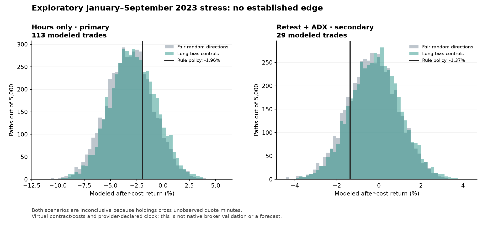

# Completed week and longer-history research — October 31, 2026

**The bot still has no established dependable edge.** The new native week was profitable on three and one trades. A larger independent modeled scenario lost money, failed its numerical evidence gates, and remained inconclusive because of unobserved quote intervals. The original full-year data test was rejected before returns were calculated.

## Completed native week: October 26–30

Each profile independently starts with USD 100,000 simulated equity and 0.25% planned stop risk. This is one weekly block. October 26–29 had already been inspected; October 30 adds one completed day. The combined week is not a new untouched five-day validation, and its return must not be added to earlier independent account runs.

| Unchanged native profile | Closed trades | After-cost net USD | Return | Cost-stress return |
|---|---:|---:|---:|---:|
|Hours only · primary|3|+655.22|+0.65522%|+0.64982%|
|Retest + ADX · secondary|1|+475.84|+0.47584%|+0.47368%|

The frozen EA/source and installed binary were unchanged. Its entry and closing windows were quoted throughout, including Friday 17:00. Journals balance, all positions closed on the entry day, swaps were zero, and neither profile recorded rejected orders, market-closed attempts or indicator warm-up skips. The one-week confidence guard correctly withheld an interval.

The longer trace differs from the earlier four-day export only in its prior final 23:59 minute: it includes nine additional ticks through 23:59:59, while that earlier test stopped at 23:59:58. No quotes were repaired. Broker trading-session metadata also changed between runs; the intended entry/closing windows remained open. This is recorded in [execution verification](completed_week_verification.json), not hidden as an immutable historical setting.

## Larger independent scenario

The fixed full 2023 archive attempt failed clock-quality checks. Of 15 monthly tick files, October 2022 and October 2023 each contained an unexplained one-hour timestamp reversal. The original full-year study remains **NOT RUN**; no failed month was silently sorted or normalized.

Before any independent-feed returns were calculated, a separate exploratory plan selected the longest contiguous valid monthly block: November–December 2022 warm-up and January 1–October 1, 2023 evaluation (January–September). The later valid November/December 2023 files were retained in the audit and excluded from this scenario. This was a timestamp-quality selection, not a return-based winner search. It does not satisfy the rejected full-year plan or constitute prospective validation.

The source uses actual paired bid/ask ticks, converted by the provider's stated fixed EST +5 hours. Its physical UTC alignment is not independently certified. Numeric 07:00–20:00/Friday 17:00 hours are a provider-clock scenario, not assumed to match the original broker's unknown offset. The 1:100 leverage, 100-ounce contract, 0.01 minimum lot, USD 7/lot commission and 0.10 price slippage per side are declared virtual assumptions. Entry/exit quotes retain provider precision; only protective levels use a 0.01 price grid. Observed quoted minutes are assumed fillable; no broker trading calendar is fabricated.

| Exploratory model profile | Trades | Return | Fair-control percentile | Long-bias percentile | Doubled-cost return |
|---|---:|---:|---:|---:|---:|
|Hours only · primary|113|-1.963%|70.84|65.52|-2.961%|
|Retest + ADX · secondary|29|-1.371%|19.20|15.62|-1.631%|

Each control uses 5,000 paths within the same execution engine and strategy-conditioned opportunities. The primary profile has 113 trades, yet its return is negative, its rank is below the 95th-percentile thresholds, and its weekly expectancy interval spans zero. Retest has 29 trades and also loses money. The ranges and ranks are descriptive model outputs, not probabilities of future profit.

| Profile | Executed holds crossing unobserved minutes | Overnight trades | Declared financing charged USD |
|---|---:|---:|---:|
|Hours only · primary|53 / 113|2|-50.09823|
|Retest + ADX · secondary|14 / 29|0|0.00000|

Absence of a quote may reflect a closed market or missing feed data; the study does not guess which. Price-path gaps prevent a complete-path evidence pass for both profiles. Every affected trade and its modeled return was retained rather than dropped to improve performance. Some modeled closes were delayed until the next observed quote. Static financing assumptions were applied across crossed midnights; those rates are not verified provider rates for 2023. Actual first/last quote bounds were preserved, while execution timestamps use whole-second precision and M1 OHLC still cannot reproduce intraminute ordering. No native/live broker execution equivalence is claimed.

## What improved

An independent signal implementation matches all 236 recorded native opportunities by minute and direction. Three native events occur one second after their M1 timestamp; the older minute archive cannot expose that first-tick second. EMA/ATR/ADX differences on the matching inputs are limited to CSV rounding. It reproduces MetaTrader's ATR/iADX arithmetic rather than substituting a typical Wilder implementation.

A further seven native opportunities in the completed week match timestamps/directions and entry quotes. Full numeric parity is not claimed on that stitched chart/tick input: EMA differs by up to 0.002209 because of an input-history boundary. No rule or price was changed to fit it. See [signal parity](signal_parity_summary.json) and [the additional check](signal_parity_completed_week.json).

The independent adapter requires actual both-side OHLC and first/last tick bounds, records gaps and finer quote precision, applies financing to delayed closes, and forces inconclusive status when a valid direction path contains unobserved minutes. It never reconstructs asks from a fixed spread or removes losing trades on coverage grounds.

The public test suite has **63 passing tests** after these additions. The EA signal/risk/exit rules remain frozen. Old studies and losing cases are retained.

## Decision and reproducibility

These results do not justify promoting either bot as reliably profitable. Keep the existing [future validation protocol](NEXT_VALIDATION.md) fixed. A favorable primary result would still require credible quote coverage, realistic execution/costs and untouched replication; additional filters tuned to these dates would be a new experiment, not a repair of failed validation.

See the [15-month source audit](independent_source_quality_audit.json), [explicit source selection](independent_source_selection.json), and the [original rejected plan](../results/independent_2023_cleanblock/original_full2023_plan.json) alongside the [amended local plan](../results/independent_2023_cleanblock/study_plan.json). Plans were recorded locally before the corresponding return calculations and published afterwards; they are not externally timestamped preregistrations. Derived journals, control distributions and coverage metadata are under `results/independent_2023_cleanblock/`; native week journals are under `data/week_20261026_30/` and `results/week_20261026_30/`. Continuous quote history and raw archives are excluded.

Source references: [HistData FAQ](https://www.histdata.com/f-a-q/), [official download page](https://www.histdata.com/download-free-forex-data/), [MetaQuotes testing behavior](https://www.mql5.com/en/docs/runtime/testing). A requested 2023 native broker probe produced no fresh quote export and was not substituted with older cached data.
